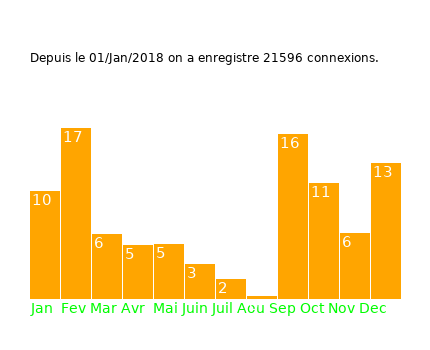
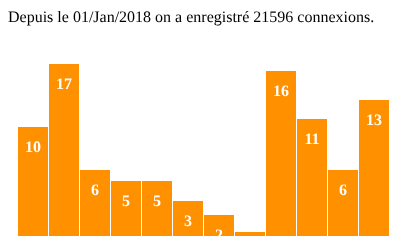

# Analyseur de logs Apache en C


Outil en ligne de commande qui lit le journal d'accès d'un serveur web **Apache** (`access.log`) et en tire des statistiques de fréquentation. Il repère aussi les requêtes suspectes et les navigateurs utilisés.

Mini-projet de 1re année de **DUT Réseaux & Télécommunications** (2020).

<p align="center">
  
</p>

## Fonctionnalités

- **Statistiques de fréquentation** : nombre total de connexions et répartition mensuelle en pourcentage.
- **Détection d'attaques possibles** : toute requête de plus de 900 caractères (tentatives d'injection, scans, etc.) est signalée avec l'IP d'origine.
- **Relevé des navigateurs** : extraction du user-agent de chaque requête.
- **Trois modes d'affichage** : terminal, fenêtre graphique (SDL) et page web servie en **CGI** par Apache.

## Démarrage rapide

```bash
# Dépendances (Debian / Ubuntu)
sudo apt install build-essential libsdl1.2-dev libsdl-ttf2.0-dev fonts-dejavu-core

# Compilation (analyse par défaut le log d'exemple data/access.log)
make

# Lancement
./analyseur -txt    # statistiques dans le terminal
./analyseur -gr     # histogramme dans une fenêtre (clic pour fermer)
./analyseur         # sortie HTML pour le CGI
```

## Les trois modes

### Terminal : `./analyseur -txt`

```
Depuis le 01/Jan/2018 on a enregistre 21596 connexions.
Janvier :  10.9 %
Fevrier :  17.2 %
Mars :  6.6 %
Avril :  5.5 %
Mai :  5.5 %
Juin :  3.5 %
Juillet :  2.1 %
Aout :  0.4 %
Septembre :  16.5 %
Octobre :  11.7 %
Novembre :  6.6 %
Decembre :  13.6 %
Veuillez consulter le fichier resultats/Attaques.txt pour voir les possibles hackeur du site
Veuillez consultez le fichier resultats/Navigateurs.txt pour visualiser les navigateurs utilisés lors de chaque requete
```

Les résultats bonus sont écrits dans `resultats/` :

```
$ sort resultats/Attaques.txt | uniq -c | sort -rn | head -3
    336 175.221.235.211 a sûrement attaqué le site
    318 95.49.130.62 a sûrement attaqué le site
    318 69.101.22.247 a sûrement attaqué le site
```

Sur le log d'exemple, **3 833 requêtes suspectes** sont relevées, réparties entre **31 adresses IP**.

### Graphique : `./analyseur -gr`

L'histogramme est dessiné avec une petite surcouche de SDL 1.2 (`lib/libgraphique`). Voir la capture en haut de page.

### Web (CGI) : `./analyseur`

Le programme génère une page HTML avec l'en-tête `Content-type`. Apache l'exécute comme script CGI, et l'histogramme est construit en CSS.

<p align="center">
  
</p>

## Analyser un autre log

Les chemins sont fixés à la compilation :

```bash
make clean
make LOG=/var/log/apache2/access.log
```

| Variable | Rôle | Valeur par défaut |
|---|---|---|
| `LOG` | Fichier de log à analyser | `data/access.log` |
| `RESULTATS` | Dossier des fichiers `Attaques.txt` et `Navigateurs.txt` | `resultats` |
| `STYLE` | Feuille de style injectée dans la page web | `cgi/style.html` |
| `FONT` | Police TrueType utilisée par le mode graphique | DejaVu Sans |

> [!NOTE]
> Les chemins relatifs sont résolus depuis le dossier où l'on lance le programme. Il faut donc lancer `./analyseur` depuis la racine du dépôt.

## Installation en CGI sur un serveur Apache

```bash
sudo a2enmod cgi && sudo systemctl restart apache2
make install-cgi
```

`make install-cgi` recompile le programme pour lire `/var/log/apache2/access.log` et installe dans `/usr/lib/cgi-bin/` :
- `analyseur` (version web) ;
- `analyseur-txt` (version texte) ;
- `style.html`.

Les pages sont ensuite accessibles sur `http://<serveur>/cgi-bin/analyseur` et `http://<serveur>/cgi-bin/analyseur-txt`.

> [!WARNING]
> Par défaut, l'utilisateur d'Apache (`www-data`) n'a pas le droit de lire ses propres logs. Pour un usage en TP ou sur une VM de test, ajoute-le au groupe `adm` (`sudo usermod -aG adm www-data`). **N'expose pas** ces statistiques sur un serveur public : elles contiennent des adresses IP.

## Structure du dépôt

```
.
├── src/
│   └── versiondynamique.c   # Programme : lecture du log, statistiques, affichages
├── lib/
│   └── libgraphique.c/.h    # Surcouche SDL fournie pour le cours
├── cgi/
│   ├── analyseur-txt        # Script CGI pour la version texte
│   └── style.html           # CSS de l'histogramme web
├── data/
│   ├── access.log           # Log d'exemple (~21 600 requêtes, 2018, anonymisé)
│   └── access_exemple.log   # Petit log d'exemple (998 requêtes)
├── docs/
│   ├── libgraphique.pdf     # Notice de la bibliothèque graphique
│   └── img/                 # Captures d'écran
└── Makefile
```

## Données

Les logs fournis proviennent d'un vrai serveur web (2018). **Ils ont été anonymisés** : chaque adresse IP publique est remplacée par une adresse fictive. Une même IP donne toujours la même adresse fictive, de même longueur, si bien que les statistiques et la détection d'attaques produisent exactement les mêmes résultats qu'avec les données d'origine.

## Limites connues

Le code est celui d'un projet de 1re année et il est conservé tel quel. Deux corrections minimales ont été nécessaires pour qu'il fonctionne avec un compilateur moderne 64 bits :

| Problème | Correction |
|---|---|
| `line()` renvoyait l'adresse d'un tableau local (comportement indéfini, plantage avec GCC récent). | Le tableau est déclaré `static`. |
| `navig()` lisait et écrivait hors du tableau sur les lignes sans user-agent classique. | Ajout de vérifications de limites. |

Les autres limites :
- La détection d'attaques repose uniquement sur la longueur de la requête.
- Le relevé des navigateurs est approximatif : il garde le premier mot du user-agent, souvent `Mozilla`.
- Le fichier est relu en entier à chaque exécution, il n'y a pas d'analyse en temps réel.
- La bibliothèque graphique est en **SDL 1.2**, qui est obsolète.

## Évolutions prévues

- [ ] Portage de la partie graphique en **SDL 3**
- [ ] Analyse en temps réel (suivi du fichier comme `tail -f`)
- [ ] Détection plus fine : brute force, scans, codes HTTP 4xx/5xx par IP
- [ ] Analyse d'autres journaux (`auth.log`, `journald`)

## Crédits

La bibliothèque `libgraphique` et la feuille de style de l'histogramme ont été fournies par l'équipe pédagogique du DUT R&T dans le cadre du module de programmation C.
